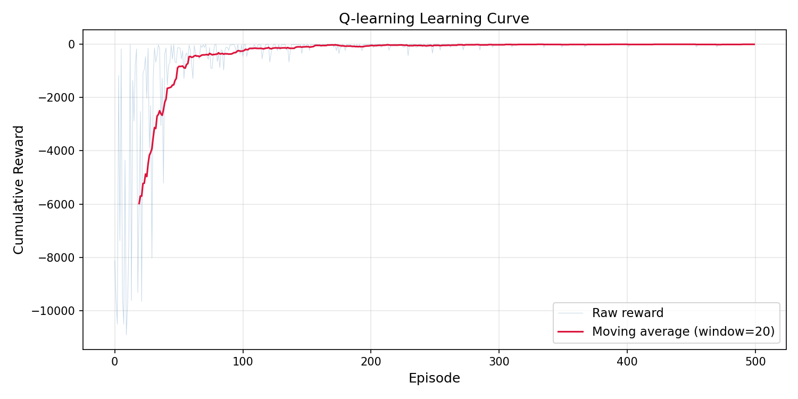
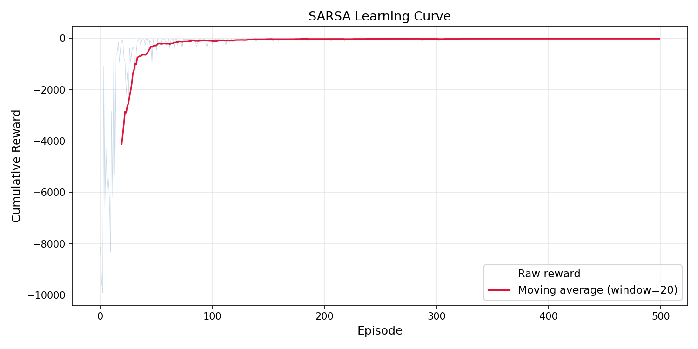
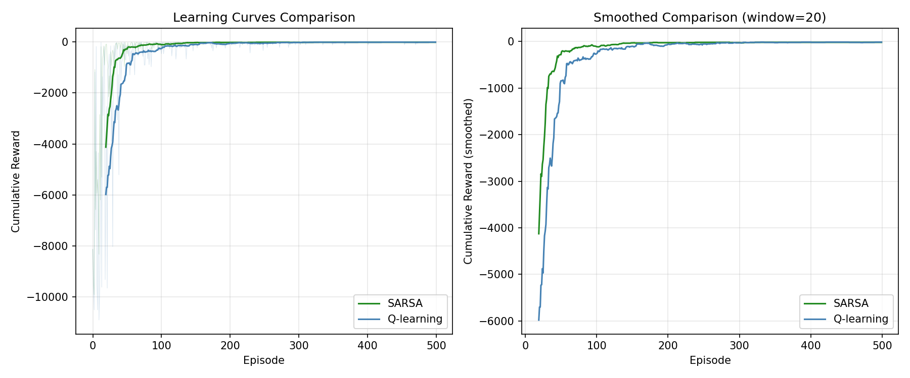

# Q-learning vs SARSA on CliffWalking / CliffWalking 上的 Q-learning 与 SARSA

From-scratch implementations of Q-learning (off-policy) and SARSA (on-policy) on Gymnasium's `CliffWalking-v1`, with training, greedy evaluation, and parameter analysis.

从零实现 Q-learning（off-policy）与 SARSA（on-policy），在 Gymnasium `CliffWalking-v1` 上完成训练、贪婪策略测试和参数分析。

## Overview / 项目简介

**English:** Both agents use an ε-greedy behavior policy and are trained with identical hyperparameters and random seeds, then evaluated with ε = 0. The project compares learning curves, success and cliff-fall rates, and sensitivity to the learning rate α and discount factor γ.

**中文：** 两种算法使用相同的超参数和随机种子训练，测试时令 ε = 0。项目对比学习曲线、成功率、坠崖率，以及学习率 α 和折扣因子 γ 对训练的影响。

## Environment / 实验环境

| Item / 项目 | Value / 说明 |
| --- | --- |
| Environment / 环境 | Gymnasium `CliffWalking-v1` |
| Grid / 网格 | 4 × 12, 48 states |
| Actions / 动作 | Up, Down, Left, Right (4 discrete actions) |
| Reward / 奖励 | −1 per step; −100 and reset to start on the cliff |
| Start → Goal / 起点终点 | (3, 0) → (3, 11) |
| Optimal safe path / 最优安全路径 | Along the cliff edge, one cell away from the cliff |

## Algorithms / 算法

Q-learning (off-policy):

$$
Q(S,A) \leftarrow Q(S,A) + \alpha \left[ R + \gamma \max_{a} Q(S',a) - Q(S,A) \right]
$$

SARSA (on-policy):

$$
Q(S,A) \leftarrow Q(S,A) + \alpha \left[ R + \gamma Q(S',A') - Q(S,A) \right]
$$

**English:** Q-learning bootstraps from the greedy next action, so its target policy is independent of exploration. SARSA bootstraps from the action actually chosen by the current ε-greedy policy, so it accounts for exploration risk.

**中文：** Q-learning 用下一状态的最大 Q 值自举，目标策略与探索策略无关；SARSA 用当前 ε-greedy 策略实际选择的下一动作自举，因此会把探索带来的风险计入更新。

## Hyperparameters / 超参数

| Parameter / 参数 | Value / 取值 |
| --- | --- |
| Learning rate α / 学习率 | 0.1 |
| Discount factor γ / 折扣因子 | 0.99 |
| Exploration ε / 探索率 | 1.0 → 0.001, multiplied by 0.99 each episode |
| Training episodes / 训练轮数 | 500 |
| Max steps per episode / 单轮最大步数 | 1000 |
| Evaluation / 测试 | 100 episodes, ε = 0 |
| Random seed / 随机种子 | 42 |

## Results / 实验结果

Greedy evaluation (100 episodes, ε = 0):

| Algorithm / 算法 | Avg return / 平均累积奖励 | Avg steps / 平均步数 | Success / 成功率 | Cliff fall / 坠崖率 |
| --- | ---: | ---: | ---: | ---: |
| Q-learning (off-policy) | −13.00 ± 0.00 | 13.0 | 100% | 0% |
| SARSA (on-policy) | −17.00 ± 0.00 | 17.0 | 100% | 0% |

**English:** Both agents reach the goal in every test episode. Q-learning follows the 13-step shortest path along the cliff edge, while SARSA takes a 17-step route one cell away from the cliff. This is the classic off-policy/on-policy difference: Q-learning is optimistic about the greedy next action, whereas SARSA evaluates the exploratory behavior it actually follows and therefore learns a more conservative path. SARSA is also safer during training: its average return over the first 100 episodes is about −1039, versus −1858 for Q-learning.

**中文：** 两种算法在测试中均 100% 到达终点。Q-learning 学到 13 步的最短路径，紧贴悬崖边缘；SARSA 学到 17 步的路径，与悬崖保持一格距离。这是 off-policy 与 on-policy 的典型差异：Q-learning 对下一状态的贪心动作更乐观，而 SARSA 评估自身实际执行的探索策略，因此学到更保守的路径。SARSA 在训练早期也更安全：前 100 轮平均累积奖励约 −1039，Q-learning 约 −1858。

**Parameter analysis / 参数分析：**

**English:** α = 0.1 gives the most stable curve; α = 0.5 learns faster but oscillates more; α = 0.9 is visibly unstable, especially for SARSA. γ = 0.99 is the best overall trade-off; γ = 0.9 converges early but settles at a worse return, and γ = 0.999 learns more slowly without a clear gain.

**中文：** α = 0.1 的曲线最稳定；α = 0.5 前期收敛更快但波动更大；α = 0.9 明显不稳定，SARSA 尤其明显。γ = 0.99 综合表现最好；γ = 0.9 收敛较早但最终回报较差，γ = 0.999 收敛更慢且没有明显收益。

## Figures / 结果图

### Learning curves / 学习曲线

| Q-learning | SARSA |
| :---: | :---: |
|  |  |

### Comparison / 对比



### Parameter analysis / 参数分析

| Algorithm / 算法 | Learning rate α | Discount factor γ |
| :---: | :---: | :---: |
| Q-learning | [α analysis](figures/qlearning_alpha_analysis.png) | [γ analysis](figures/qlearning_gamma_analysis.png) |
| SARSA | [α analysis](figures/sarsa_alpha_analysis.png) | [γ analysis](figures/sarsa_gamma_analysis.png) |

## Project structure / 项目结构

```text
.
├── qlearning.py      # Q-learning agent, training, testing, parameter analysis
├── sarsa.py          # SARSA agent and comparison with Q-learning
├── figures/          # Generated learning curves and parameter analysis
├── requirements.txt
├── LICENSE
└── README.md
```

`sarsa.py` imports shared utilities from `qlearning.py`; keep both files in the same directory.

`sarsa.py` 会从 `qlearning.py` 导入公共函数，两个文件需放在同一目录。

## Getting started / 快速开始

Tested with Python 3.12 and the versions in `requirements.txt`.

使用 Python 3.12 和 `requirements.txt` 中的版本验证。

```bash
git clone <repository-url>
cd cliffwalking-qlearning-sarsa

python -m venv .venv
# Windows
.venv\Scripts\activate
# macOS / Linux
source .venv/bin/activate

pip install -r requirements.txt

python qlearning.py
python sarsa.py
```

Results are written to `figures/`. Each script trains several thousand episodes in total, so a full run takes a few minutes. On a headless machine, use `MPLBACKEND=Agg python qlearning.py`.

运行结果写入 `figures/`。每个脚本累计训练数千个 episode，完整运行需要几分钟。无图形界面时可用 `MPLBACKEND=Agg python qlearning.py`。

## License / 许可证

Released under the MIT License. See [LICENSE](LICENSE).

本项目采用 MIT 许可证，详见 [LICENSE](LICENSE)。
